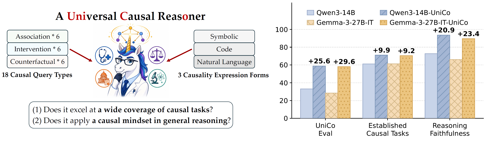

<h1 align="center">Towards a <ins>Uni</ins>versal <ins>C</ins>ausal Reas<ins>o</ins>ner</h1>

<p align="center">
  
</p>

<p align="center">
  💻 <a href="https://github.com/ChicagoHAI/UniCo">Code</a> ·
  🤗 <a href="https://huggingface.co/collections/ChicagoHAI/unico">Data</a> ·
  📜 <a href="https://arxiv.org/abs/2605.24873">Paper</a>
</p>

---

UniCo is a data generation framework for training LLMs to reason causally. It covers 18 causal query types across Pearl's Causal Ladder, and it renders natively symbolic examples as code and natural language to simulate real-world use cases where causal terms are not stated explicitly. Answers come from exact causal inference, and cases with reasoning shortcuts are filtered out.

After supervised fine-tuning on 66.6K UniCo instances, Qwen3-4/8/14B, Olmo-3-7B-Instruct, and Gemma-3-27B-IT improve by an average of 24.8% across the 18 query types, and by 9.3% over state-of-the-art causal data generation frameworks on 7 established causal benchmarks outside the training distribution. Please refer to our [paper](https://arxiv.org/abs/2605.24873) for details.

<p align="center">
  
</p>

## What's here

| Stage | Where | What it does |
| --- | --- | --- |
| **Data generation** | [`data_generation/`](data_generation/) | Samples causal graphs and queries, computes exact answers, and renders each question in symbolic, code, and natural-language form. |
| **In-distribution evaluation** | [`id_eval/`](id_eval/) | Evaluates a model on UniCo's 44 evaluation files. |
| **Out-of-distribution evaluation** | [`ood_eval/`](ood_eval/) | Evaluates a model on BBEH, CaLM, CLadder, Com2, Corr2Cause, CounterBench, and Executable Counterfactuals. |

## Quickstart

Run all commands from the repository root.

```bash
conda create -n unico python=3.11 -y
conda activate unico
pip install -r requirements.txt
```

### Download the data

```bash
./id_eval/scripts/download_unico_data.sh
```

This writes UniCo's evaluation files from [Hugging Face](https://huggingface.co/datasets/ChicagoHAI/UniCo) to `./data/unico/`, the layout the evaluation reads:

```text
data/unico/
├── ate/
│   ├── ate-eval.jsonl         # Symbolic form.
│   ├── ate-code-eval.jsonl    # Code form.
│   └── ate-nl-eval.jsonl      # Natural-language form.
├── backdoor/
│   └── backdoor-eval.jsonl
└── ...                        # One directory per query type.
```

The prompt files of the out-of-distribution benchmarks are already in this repository.

### Evaluate a model

```bash
./id_eval/scripts/eval_id_qwen3_4b.sh 0      # In-distribution, on GPU 0.
./ood_eval/scripts/eval_ood_qwen3_4b.sh 0    # Out-of-distribution, on GPU 0.
```

Each suite has one script per model: `qwen3_4b`, `qwen3_8b`, `qwen3_14b`, `olmo3_7b`, and `gemma3_27b`. Pass a local checkpoint of the same model family as a second argument. Gemma 3 is a gated model, so accept its license on Hugging Face and run `hf auth login` first.

Results are averaged over three rounds. The final tables are in `./results/{id_eval,ood_eval}/integrated-outputs/<model>/mds/*-cross_round.md`.

### Generate data

```bash
./data_generation/ate/scripts/ate_query_sampling_pipeline_v1.1.sh
./data_generation/ate/scripts/ate_question_assembly_pipeline_v1.1.sh
```

[`data_generation/README.md`](data_generation/README.md) walks through the full pipeline for all query types.

## Citation

```bibtex
@inproceedings{dai2026towards,
  title={Towards a Universal Causal Reasoner},
  author={Dai, Qirun and Liu, Xiao and Zhang, Jiawei and Zhang, Dylan and Peng, Hao and Tan, Chenhao},
  booktitle={The Fortieth Annual Conference on Neural Information Processing Systems},
  year={2026},
  url={https://openreview.net/forum?id=MeL6BM40Ro}
}
```
